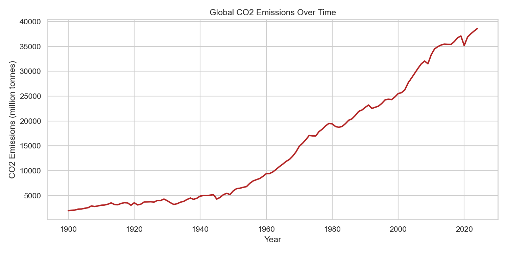
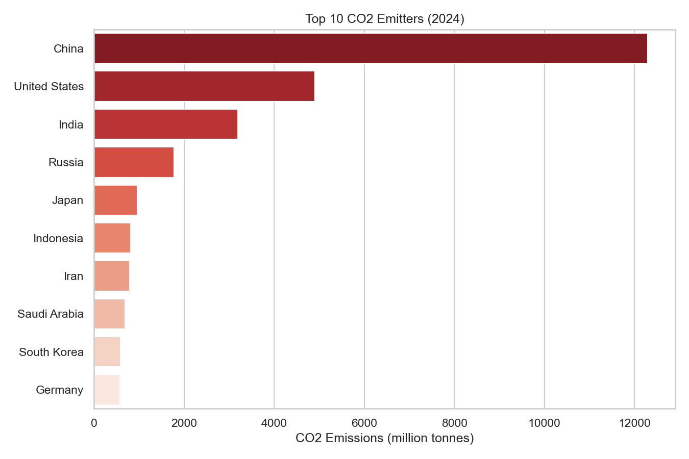
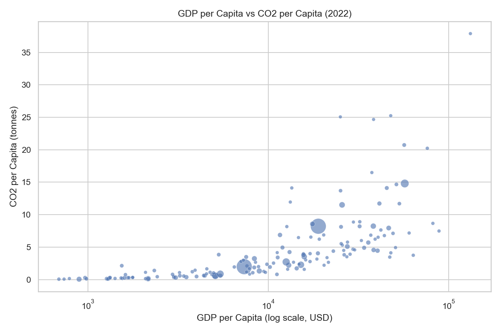
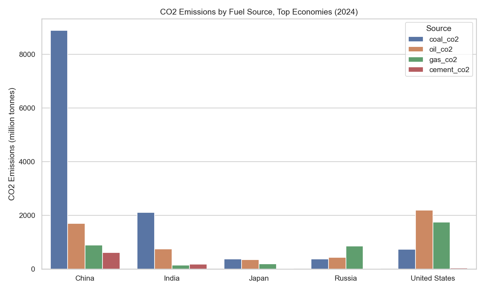
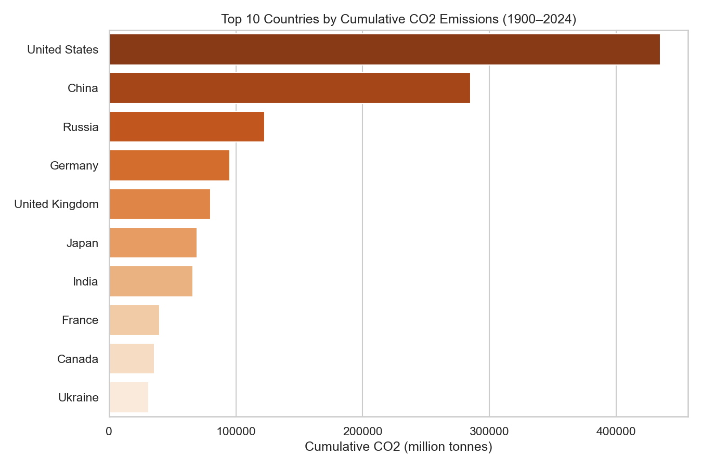

# Global CO2 Emissions Analysis (1900–Present)

An end-to-end data analysis project using [Our World in Data's CO2 dataset](https://github.com/owid/co2-data),
covering data cleaning and exploratory analysis in Python.

## Project Overview

- **Source data:** OWID CO2 and Greenhouse Gas Emissions dataset (country-year panel, 1900–2024)
- **Tools:** Python (pandas, matplotlib, seaborn)
- **Goal:** Identify long-term emissions trends, the largest current and historical emitters,
  and the relationship between economic development and per-capita emissions.

## Key Findings

- Global CO2 emissions reached ~38.6 billion tonnes in 2024, driven mainly by China, the US, and India.
- China and the US together account for roughly 45% of current annual emissions, but the US has emitted
  far more cumulatively since 1900, the "current emitter vs. historical responsibility" tension is the
  central story of this analysis.
- GDP per capita and CO2 per capita are positively correlated (r ≈ 0.74) among the 68% of country-years
  with usable GDP data, though several high-income countries have partially decoupled.
- Coal remains the dominant emissions source for China and India, while oil and gas dominate for the US.

## Repository Structure

```
co2-emissions-analysis/
├── data/
│   ├── raw/                    # original OWID CSV (gitignored, downloaded via setup step)
│   └── processed/               # cleaned CSVs
├── notebooks/
│   └── co2_analysis.ipynb        # cleaning + EDA notebook
├── scripts/
│   ├── cleaning.py               # data cleaning pipeline
│   └── analysis.py               # exploratory analysis + chart generation
├── reports/                    # generated charts (PNG) — embedded below
├── requirements.txt
└── README.md
```

## Setup

```bash
git clone https://github.com/SrujanaJasmine/CO2-Emission-Analysis.git
cd co2-emissions-analysis
pip install -r requirements.txt

# Download the raw dataset
curl -L -o data/raw/owid-co2-data.csv \
  https://raw.githubusercontent.com/owid/co2-data/master/owid-co2-data.csv

# Run the pipeline
python scripts/cleaning.py
python scripts/analysis.py
```

## Data Cleaning

Reduced ~79 raw columns to 17 relevant fields, filtered to 1900 onward, and separated country-level
rows from OWID's regional/income-group aggregates (mixing them would double-count global totals).

**Missing values are handled per-column, not with a single blanket rule**,the reason for missingness
differs by column, so the fix does too:

| Column type | Missing % | Why | Handling |
|---|---|---|---|
| Fuel sources (`coal_co2`, `oil_co2`, `gas_co2`, `cement_co2`) | 4–41% | Genuinely zero for many countries | Filled with 0 |
| `gdp` | 20–32%, 100% in the latest year | Structural reporting lag | Left as `NaN`; flagged with `has_gdp` |
| `energy_per_capita`, `primary_energy_consumption` | 50% | No OWID energy data exists before 1965 | Left as `NaN`; flagged with `has_energy_data` |
| `co2_growth_prct` | 1.8% | A country's first year, or growth from a 0 baseline (0/0 is undefined) | Left as `NaN` — mathematically correct, not missing |
| `population`, `co2_per_capita` | <1% | Small genuine gaps | Dropped only within analyses that need them |

`has_gdp` and `has_energy_data` are kept as boolean columns so any downstream analysis can filter to
genuine coverage rather than silently treating missing data as zero.

## Analysis & Visualizations

### 1. Global emissions trend
Global CO2 emissions have risen sharply since industrialization, with acceleration after 1950.



### 2. Top emitters today
China, the US, and India dominate current annual emissions.



### 3. GDP vs. CO2 per capita
GDP per capita and CO2 per capita show a moderate-to-strong positive correlation (r ≈ 0.74), though
some high-income countries have partially decoupled economic growth from emissions.



### 4. Fuel source breakdown
Coal dominates emissions in China and India; oil and gas dominate in the US, reflecting very
different energy mixes among the largest economies.



### 5. Cumulative historical responsibility
The US has emitted far more cumulatively since 1900 than any other country, despite China now leading
in annual emissions which is a key tension in climate policy debates about historical responsibility.



## License

Data: [OWID CO2 Data](https://github.com/owid/co2-data), licensed CC BY 4.0.
